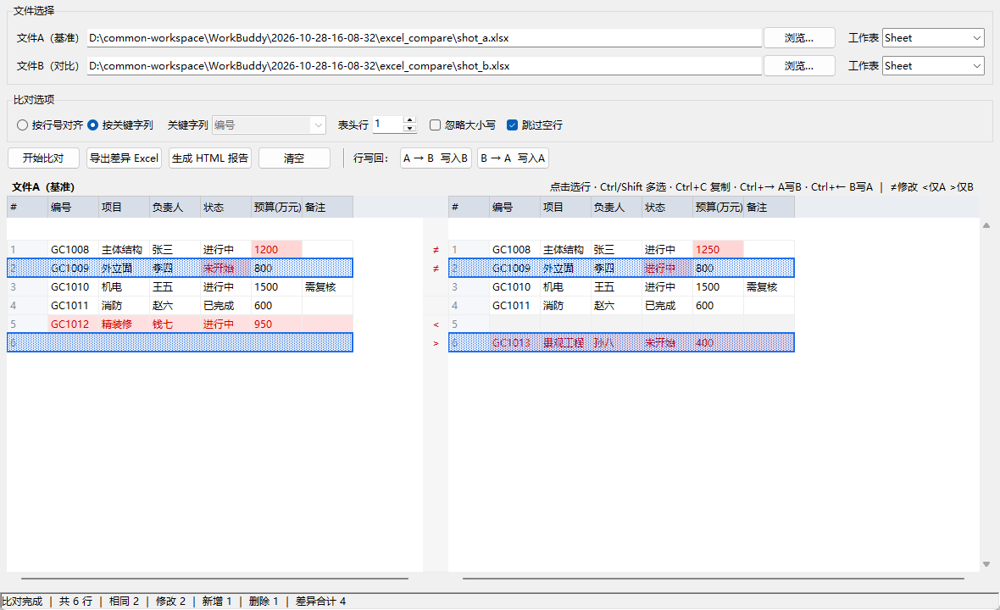
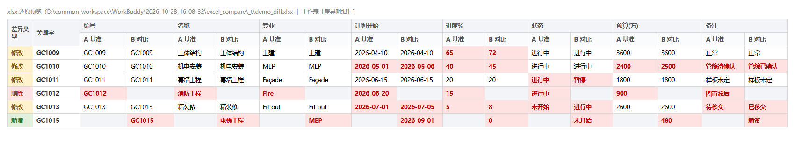
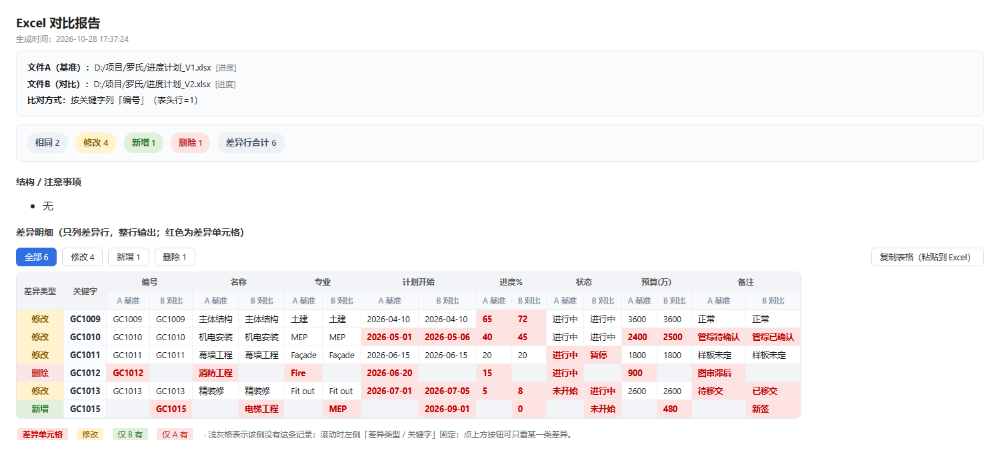

# ExcelDiff

两个 Excel 文件的差异对比工具。类 Beyond Compare 的**左右双栏视图**，逐行对齐、差异单元格**红色高亮**，并且可以把差异行**一键写回源文件**。

Windows 桌面程序，Python + tkinter 编写，打包为单文件 exe，无需安装 Python 或 Office。



---

## 功能特性

**对比**

- 支持 `.xlsx` / `.xlsm` / `.xls`
- 两种对齐方式：**按行号对齐**（逐行逐列比）或**按关键字列**（按指定列匹配，适合行顺序不一致）
- 可设置表头行、忽略大小写、跳过空行
- 左右双栏同步滚动，差异单元格红色高亮，中间状态栏标注 `≠` 修改 / `<` 仅 A 有 / `>` 仅 B 有
- 自动提示结构差异（只在 A 有的列、只在 B 有的列、关键字重复）

**交互**

- 点击选行、`Ctrl` 加选、`Shift` 连选、拖拽框选
- 复制到剪贴板（TSV，可直接粘贴进 Excel / 微信 / 文本）
- 右键菜单提供"复制当前栏 / 复制指定栏 / 含表头 / 复制为差异文本"

**写回源文件**

- 选中差异行 → 从 A 写到 B（或 B 写到 A）→ **直接修改源文件**
- 改动前先弹确认框，首次写入自动备份
- 写成功后自动重新读取、重新比对、刷新界面

**导出报告**

- **差异 Excel**：一条差异 = 一整行，每个字段的 A 值 / B 值并排，差异单元格标红
- **HTML 报告**：同样版式，带分类筛选与"复制表格"按钮，浏览器直接打开

---

## 快速开始

### 方式一：直接运行 exe（推荐）

1. 下载 [`dist/ExcelDiff.exe`](dist/ExcelDiff.exe)（约 13.8 MB，单文件免安装）
2. 双击运行即可，无需安装 Python、无需安装 Office

> 首次运行 Windows 可能提示"未知发布者"，点"更多信息 → 仍要运行"。

### 方式二：从源码运行

```bash
pip install openpyxl xlrd
python main.py
```

环境要求：Python 3.8+，且解释器需带 tkinter（官方安装包默认包含）。

---

## 使用说明

1. **选择文件**：分别点「浏览…」选文件 A（基准）和文件 B（对比），并各自选择要对比的工作表
2. **选择比对方式**
   - `按行号对齐`：两个表行顺序一致时用，第 N 行和 第 N 行比
   - `按关键字列`：行顺序可能变化时用，从下拉选一列作为主键（如 `编号`、`Key`），按主键配对后再比
3. **开始比对**：点「开始比对」，下方双栏显示结果，底部状态栏给出统计
4. **查看与复制**：单击/`Ctrl`/`Shift` 选行，`Ctrl+C` 复制
5. **写回（可选）**：选中差异行 →「A → B 写入B」或「B → A 写入A」
6. **导出（可选）**：「导出差异 Excel」或「生成 HTML 报告」

---

## 比对方式

| 模式 | 适用场景 | 配对依据 |
|---|---|---|
| 按行号对齐 | 两个表结构、行顺序完全一致（如月度版本迭代） | 行序号 |
| 按关键字列 | 行顺序有增删调整（如翻译表按 Key、清单按编号） | 指定列的值 |

**差异状态**

| 状态 | 含义 | 双栏表现 |
|---|---|---|
| 相同 | 所有列的值都一样 | 白底 |
| 修改 | 主键相同，但有若干列值不同 | 差异单元格红色高亮，两侧都标 |
| 新增 | 只有 B 有这条记录 | 右栏整行标红，左栏空 |
| 删除 | 只有 A 有这条记录 | 左栏整行标红，右栏空 |

---

## 写回源文件

选中差异行后点工具栏按钮（或右键菜单 / 快捷键），程序会把改动**直接写入源文件**。

| 选中行的状态 | 点「A → B 写入B」的结果 |
|---|---|
| 修改 | 只把**变化的那些列**写进 B，B 其余单元格与公式保持不动 |
| 新增（仅 B 有） | 跳过（A 侧没有内容可写） |
| 删除（仅 A 有） | 整行**追加到 B 表尾** |
| 相同 | 跳过（避免把 B 里的公式覆盖成静态值） |

反方向（B → A）规则对称。

**"移动"一行** = 先 `A → B` 追加到 B，再从 A 删除该行。右键菜单里有「从 A 删除选中行 / 从 B 删除选中行」，两步都支持。

**安全机制**

- 点按钮后先弹确认框，列出目标文件、工作表、覆盖几行 / 追加几行 / 删除几行
- 首次写入某文件前自动备份为 `<原文件名>.bak-<时间戳>.xlsx`（保留 `.xlsx` 扩展名，双击即可用 Excel 打开），同一会话内每个文件只备份一次
- 所有校验（表头缺失、行号落在表头区、目标列不存在）都在保存之前抛出，**失败不落盘**
- `.xls` 老格式拒绝写入，提示先另存为 `.xlsx`；`.xlsm` 用 `keep_vba=True` 保留宏
- 目标文件正在 Excel 中打开时会写入失败，程序会提示关闭后重试

---

## 导出格式

### 差异 Excel

- 表头两行：
  - 第 1 行 `差异类型 | 关键字 | 字段1 | 字段2 | ...`（字段名跨两列合并）
  - 第 2 行 每对下方 `A 基准 | B 对比`
- 数据从第 3 行起，冻结窗格锁住表头与前两列
- 每个字段的 A 值 / B 值并排，**差异单元格浅红底 + 深红粗体**，A、B 两侧都标
- 新增行的 A 侧、删除行的 B 侧填浅灰（表示该侧没有这条记录）
- 只输出差异行，相同行不写入
- 数值保持数字类型（不是文本），复制出去还能继续计算
- 第二个 sheet「汇总」记录文件名、工作表、比对方式、生成时间、各类行数



### HTML 报告

同样版式，额外提供：

- 顶部按钮 `全部 / 修改 / 新增 / 删除` 一键筛选
- 右上「复制表格（粘贴到 Excel）」：把当前可见行按 TSV 写入剪贴板
- 左侧「差异类型 / 关键字」两列横向滚动时固定



仓库内附示例产物：[`示例_差异导出.xlsx`](示例_差异导出.xlsx)、[`示例_对比报告.html`](示例_对比报告.html)。

---

## 快捷键

| 快捷键 | 作用 |
|---|---|
| 单击 | 选中一行（左右两栏同步高亮） |
| `Ctrl` + 单击 | 加选 / 取消选中 |
| `Shift` + 单击 | 从锚点连续范围选择 |
| 拖拽 | 框选连续多行 |
| `Ctrl+A` | 全选 |
| `Esc` | 清除选择 |
| `Ctrl+C` | 复制选中行（当前点击那一栏，TSV） |
| `Ctrl+→` | 选中的差异行从 A 写到 B |
| `Ctrl+←` | 选中的差异行从 B 写到 A |
| 滚轮 | 垂直滚动（左右同步） |
| `Shift` + 滚轮 | 单栏横向滚动 |

---

## 命令行参数

主要用于自动化验证，不影响正常图形界面使用。

```bash
# 自检：生成临时文件跑一遍比对 + 导出 + 写回，结果写入文本文件
ExcelDiff.exe --selftest out.txt

# 读取探测：打印某个 Excel 的工作表、行列数与表头，用于排查"读不出来"
ExcelDiff.exe --read "E:/book.xlsx" out.txt
```

`--read` 的典型用途：某个文件在界面上看不到内容时，用它确认到底是文件本身为空、工作表选错，还是解析异常。

---

## 从源码打包 exe

```bash
pip install openpyxl xlrd pyinstaller

pyinstaller --onefile --windowed --name ExcelDiff ^
  --hidden-import openpyxl --hidden-import xlrd ^
  --exclude-module PIL --exclude-module numpy --exclude-module lxml ^
  main.py
```

产物在 `dist/ExcelDiff.exe`。排除 `PIL / numpy / lxml` 可显著减小体积（这是 `openpyxl` 的可选依赖，本程序用不到）。

---

## 项目结构

```
excel_compare/
├── main.py              主程序（比对引擎 + 双栏视图 + 写回 + 导出）
├── dist/
│   └── ExcelDiff.exe    打包好的单文件可执行程序
├── README.md            本文件
├── LICENSE              MIT 许可证
├── .gitignore
├── test_engine.py       比对引擎测试（对齐/修改/新增/删除/结构差异）
├── test_writeback.py    写回测试（行号映射/覆盖/追加/删除/备份/样式保留）
├── test_export.py       导出测试（表头合并、只输出差异行、差异列标红）
├── test_select_copy.py  选中与复制测试（行定位、范围选择、TSV）
├── test_gui_smoke.py    界面冒烟测试（建窗、喂数据、强制重绘）
├── test_gui_move.py     界面写回端到端测试（选中 → 写入 → 校验文件）
├── demo_export.py       生成示例差异文件（配合预览）
├── preview_xlsx.py      把导出的 xlsx 还原成 HTML，便于检查版式
├── probe_html.py        往 HTML 报告注入探针，实跑筛选/复制逻辑
├── shot.py              渲染窗口并截图
├── preview.png          主界面截图
├── preview_html.png     HTML 报告截图
├── preview_xlsx.png     导出 Excel 截图
├── 示例_差异导出.xlsx    示例产物
└── 示例_对比报告.html    示例产物
```

---

## 测试

```bash
# 比对引擎
python test_engine.py

# 写回引擎（会在临时目录生成文件，不改动你的数据）
python test_writeback.py

# 导出格式
python test_export.py

# 选中与复制
python test_select_copy.py

# 界面冒烟 / 端到端写回
python test_gui_smoke.py
python test_gui_move.py

# 程序内置自检（打包后也能跑）
python main.py --selftest out.txt
```

界面相关测试需要图形环境（Windows 桌面或有显示服务的环境）。

---

## 已知限制

- **只对比单个工作表**：一次比一个 sheet，多表批量对比暂未实现
- **追加写到表尾**：新增/删除行写回时追加到目标表末行，而不是插到对应位置。因为插入会让下方所有行号整体下移、容易错位；如需"保持排序的插入"，需改成按关键字重新定位并逐行重排
- **`.xls` 只能读不能写**：老格式写回需先另存为 `.xlsx`
- **文件被占用时无法写入**：目标文件正在 Excel 中打开会失败，关闭后重试
- **不解析公式计算结果以外的东西**：读取时用 `data_only=True`，拿到的是缓存值；若文件从未被 Excel 打开计算过，公式单元格可能显示为空
- **超宽表需横向滚动**：列数很多时单栏可见列有限，用 `Shift` + 滚轮横向滚动

---

## 许可证

本项目基于 [MIT License](LICENSE) 开源，可自由使用、修改、分发，包括商业用途，仅需保留版权声明。

Copyright (c) 2026 sunny
